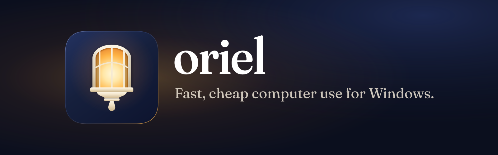

<p align="center">
  
</p>

<p align="center">
  <a href="https://github.com/YordiLorenzo/oriel/actions/workflows/build.yml"></a>
  <a href="https://github.com/YordiLorenzo/oriel/releases/latest"></a>
  <a href="LICENSE"></a>
</p>

**oriel is an MCP server that lets an AI assistant use the apps on your Windows PC. It reads each window as text,
through the accessibility tree, instead of looking at screenshots.**

Most computer-use agents send the model a picture at every step and take over your mouse to click. Windows already
describes every window as a tree of named controls, for screen readers. oriel hands that tree to the assistant, acts
on the controls directly, and answers each action with what changed, so the assistant rarely has to look twice. On
Microsoft's WindowsAgentArena, the same model finished tasks 30% faster, at 38% lower cost, with oriel than with Cua
Driver ([details](#how-it-compares)). oriel is free, open source, and one 180 KB exe that needs no admin rights.

[Download for Windows](https://github.com/YordiLorenzo/oriel/releases/latest) ·
[Set up your MCP client](#set-up-your-mcp-client) · [What it changes on your PC](#what-oriel-changes-on-your-pc) ·
[How it compares](#how-it-compares)

What the assistant sees, and what it gets back after filling a field:

```
> tree Character Map
window [264694] charmap "Character Map" at 15,65 491x437
[kqm1] Pane "Character Grid"
[kqm3] Edit "Characters to copy :" value=" "
[kqm4] Button "Select"
[kqm5] Button "Copy" (disabled)
[kqm6] CheckBox "Advanced view" off
...
> set id=kqm3 value="hello"
set "Characters to copy :"
~ [kqm3] Edit "Characters to copy :" value="hello"
~ [kqm5] Button "Copy"
(set took 9 ms)
```

## What it does

### Reads windows as text

- **Every control on one line.** `tree` lists a window's named and actionable controls, each with a ref such as
  `kqm17` that later calls use directly, without searching again.
- **Fast.** An action takes 5 to 20 ms and reading a window 20 to 60 ms ([measured](docs/benchmarks.md)). oriel
  turns off UI Automation's AutoSetFocus, which otherwise stalls every action for 2 seconds on a locked or busy
  desktop.
- **Search and wait.** `find` looks for controls by name, including off-screen ones. `wait` returns as soon as a
  window or control appears, driven by the app's own events instead of fixed sleeps.

### Acts, and says what changed

- **Change reports.** Every action replies with what changed in the window: `+` new, `~` changed, `-` gone, and
  `+ window` with the tree of a window that opened. The assistant doesn't have to read the window again to see
  whether it worked.
- **Works in the background.** `invoke`, `set`, `select` and `scroll` act through UI Automation. They don't take
  keyboard focus or move the mouse, so you can keep working while the assistant does.
- **Keys and mouse when needed.** `keys`, `click` and `drag` send real input for what has no accessibility action,
  such as spreadsheet cells, canvases and drawing. They check that the right window is in front and wait for a pause
  in your own typing first.
- **Fewer model turns.** `launch` replies with the new window's tree, `batch` runs several steps in one call, and a
  name that matches nothing comes back with the closest names.

### Keeps away from passwords and terminals

- **No shell.** No tool runs commands or reads files, and open terminals are off limits.
- **No passwords or sign-in.** Password fields, the lock screen, sign-in and UAC prompts, credential dialogs and
  common password managers can't be read or typed into.
- **It acts as you.** In an allowed window the assistant can do what you can, so an allow-list in `config.json`
  keeps it to the apps you name. [SECURITY.md](SECURITY.md) has every rule and its limits.

### Reaches your other computers

- **oriel-vnc** is the second MCP server in this repo. It runs next to the assistant and operates any desktop with a
  VNC server, such as a Mac or a Linux machine, through screenshots, clicks and keys. Nothing is installed on those
  machines. [vnc/README.md](vnc/README.md)

## Supported

| | Works | Not yet |
|---|---|---|
| **Windows** | Windows 11 (tested); Windows 10 version 1903 or later, on the .NET Framework 4.8 that Windows includes | Windows 10 isn't tested yet |
| **Apps** | Anything that exposes UI Automation: most desktop apps, Store apps, and web pages in Chromium browsers and Electron apps. WindowsAgentArena exercised Chrome, Edge, File Explorer, LibreOffice Calc and Writer, VS Code, VLC, Settings, Paint, Clock, Calculator and Notepad | Canvases and games have no accessibility tree: `screenshot`, `click` and `drag` cover them, or oriel-vnc. Apps running as administrator need oriel to run as administrator too |
| **MCP clients** | Any client that starts a stdio MCP server; tested with Claude Code | The Codex, Claude Desktop, Cursor and VS Code configs below follow each client's documented format but aren't tested |
| **A locked PC** | Reading windows and element actions | `keys`, `focus`, `click` and `drag` are refused, and Windows suspends Store apps until you unlock |
| **Other computers** | macOS, Linux and anything else with a VNC server, through oriel-vnc | |

### Tools

| Tool | What it does |
|---|---|
| `windows` | Visible windows, front first, dialogs included |
| `tree` | One window's named or actionable controls, each with a ref like `kqm17` |
| `find` | Controls whose name contains a text, including off-screen ones |
| `text` | Read a document or field |
| `wait` | Wait until a window or control appears |
| `invoke` | Press, toggle, select or expand (by ref, or window and name) |
| `set` | Fill a field, or set a slider |
| `select` | Pick an item by its text in a combo box, list, tab strip or menu |
| `scroll` | Scroll a control into view, or a list or page by a page or line |
| `keys` | Keystrokes, after the checks in [SECURITY.md](SECURITY.md) |
| `click`, `drag` | Real mouse input on a control or a point in a window |
| `launch` | Start a program, file or URI; replies with the new window's tree |
| `window` | Minimise, maximise, restore, move or resize |
| `screenshot` | A picture of one window, for canvases, charts and games |
| `focus`, `close`, `status` | Bring a window to the front, close one, see whether the PC is locked and you are idle |
| `batch` | Several of the above in one call |

Every tool and its options: [docs/tools.md](docs/tools.md). How it is built and why it is fast:
[docs/design.md](docs/design.md).

## Install

1. Download `oriel.exe` from the [latest release](https://github.com/YordiLorenzo/oriel/releases/latest). To check
   the file, compare `Get-FileHash .\oriel.exe` with the release's `SHA256SUMS`.
2. In PowerShell, in the download folder (no admin rights needed):

   ```powershell
   .\oriel.exe install
   ```

   This copies oriel to `%LOCALAPPDATA%\Programs\oriel` and starts it. Add `--autostart` if you want it running from
   the moment you sign in.
3. Add it to your assistant. For Claude Code, in the same PowerShell window:

   ```powershell
   claude mcp add --scope user oriel -- "$env:LOCALAPPDATA\Programs\oriel\oriel.exe" mcp
   ```

   Then ask Claude "Which windows are open?". Other clients and use from a Mac are under
   [Set up your MCP client](#set-up-your-mcp-client).

### Windows warns about oriel.exe

oriel isn't code-signed yet, so Windows doesn't recognise the publisher:

- **Your browser** may say the file isn't commonly downloaded. In Edge, open the download's **...** menu, choose
  **Keep**, then **Show more** and **Keep anyway**.
- **SmartScreen** may show "Windows protected your PC". Click **More info**, then **Run anyway**.
- **Smart App Control**, if it is on, blocks unsigned programs and offers no way past.
- **Antivirus** may be wary of an unsigned program that sends keystrokes and reads other windows. oriel doesn't try
  to get around it. If you'd rather not run an unsigned download, [build it yourself](#build-from-source).

Every new version starts with no reputation, so expect the same warnings when you update.

### Updating

Run `install` from the new `oriel.exe` (with `--autostart` again if you use it). It stops the running copy and
replaces it.

### Uninstalling

```powershell
& "$env:LOCALAPPDATA\Programs\oriel\oriel.exe" uninstall
```

This stops oriel, removes the logon entry if there is one, deletes the install and settings folders, and lists what
it removed. Then remove oriel from your MCP client.

## Set up your MCP client

Every client needs the same two things: the full path to the installed `oriel.exe` as the command, and `mcp` as the
argument. `install` prints the path with your user name filled in; below, replace `<you>` with it. JSON needs each
backslash doubled. Restart the client after editing its file.

| Client | Command or config file |
|---|---|
| Claude Code | `claude mcp add --scope user oriel -- "$env:LOCALAPPDATA\Programs\oriel\oriel.exe" mcp` (in PowerShell) |
| Codex | `%USERPROFILE%\.codex\config.toml` |
| Claude Desktop | `%APPDATA%\Claude\claude_desktop_config.json` |
| Cursor | `%USERPROFILE%\.cursor\mcp.json` |
| VS Code | `.vscode\mcp.json` in a workspace |

**Codex:**

```toml
[mcp_servers.oriel]
command = 'C:\Users\<you>\AppData\Local\Programs\oriel\oriel.exe'
args = ["mcp"]
```

**Claude Desktop, Cursor** and other clients with an `mcpServers` list:

```json
{
  "mcpServers": {
    "oriel": { "command": "C:\\Users\\<you>\\AppData\\Local\\Programs\\oriel\\oriel.exe", "args": ["mcp"] }
  }
}
```

**VS Code:**

```json
{
  "servers": {
    "oriel": { "type": "stdio", "command": "C:\\Users\\<you>\\AppData\\Local\\Programs\\oriel\\oriel.exe", "args": ["mcp"] }
  }
}
```

**From a Mac or Linux machine,** over SSH. The PC needs OpenSSH Server with key login:

```
claude mcp add --scope user oriel -- ssh my-windows-pc 'C:\Users\<you>\AppData\Local\Programs\oriel\oriel.exe' mcp
```

An SSH session has no desktop, so oriel passes each call to its copy running in your desktop session, and starts
that copy if it isn't running.

**oriel-vnc,** for any desktop over VNC, with [uv](https://docs.astral.sh/uv/) installed and your machines listed in
`~/.config/oriel-vnc/hosts.json` ([vnc/README.md](vnc/README.md)):

```
claude mcp add --scope user oriel-vnc -- uvx --from "git+https://github.com/YordiLorenzo/oriel#subdirectory=vnc" oriel-vnc
```

To check oriel without a client, run `& "$env:LOCALAPPDATA\Programs\oriel\oriel.exe" call windows` in PowerShell.

## What oriel changes on your PC

| Change | When | How to undo it |
|---|---|---|
| `oriel.exe` in `%LOCALAPPDATA%\Programs\oriel` | `oriel install` | `oriel uninstall` deletes the folder |
| `%LOCALAPPDATA%\oriel`: the per-user key (`token`), a counter for refs, and `config.json` if you make one | The first time oriel runs | `oriel uninstall` deletes the folder |
| A logon entry, `oriel` under `HKCU\Software\Microsoft\Windows\CurrentVersion\Run`, that starts oriel without a window | `oriel install --autostart` only | `oriel uninstall` removes it |
| A one-time scheduled task, `oriel-start`, that starts oriel in your desktop session | When a client connects over SSH and oriel isn't running; deleted once it has started | Nothing to undo |
| oriel listening on `127.0.0.1`, on a port of its own per Windows user, for clients that hold the per-user key | While it runs | `oriel uninstall` stops it; signing out does too |

oriel needs no admin rights, installs no service or driver, and makes no network connections except to itself on
`127.0.0.1`. Your AI client sends what oriel reads (window titles, control names, the text you ask it to read) to its
model provider, as it does with anything else you show it.

## How it compares

|  | oriel | Cua Driver | Screenshot-based agents |
|---|---|---|---|
| How it sees a window | The accessibility tree, as text | The accessibility tree, as text, with screenshots on request | Screenshots, read by the model |
| How it acts | Accessibility actions on the control; real keys and mouse only for `keys`, `click` and `drag` | Accessibility actions on element tokens, plus keyboard and mouse tools | Mouse clicks at pixel positions, and typing |
| What an action changed | In the same reply, control by control | Read the window again | A new screenshot, compared by eye |
| Canvases and games | `screenshot`, `click` and `drag`, or oriel-vnc | Screenshots and mouse | What they are built for |

**On WindowsAgentArena,** Microsoft's benchmark of everyday tasks in a Windows 11 VM, scored by its own scripts. Both
sides ran Claude Sonnet 5.5 in Claude Code with the same prompt and turn limit; only the MCP server was swapped. Two
runs each, averaged over the 153 tasks scored in every run:

| | oriel | Cua Driver 0.38.0 | Difference |
|---|---|---|---|
| Time per task, median | **49 s** | 70 s | oriel 30% faster |
| Model cost for all 153 tasks | **$38** | $61 | oriel 38% cheaper |
| Model turns per task | **21.8** | 27.0 | oriel 19% fewer |
| Tasks completed | 96.2 (63%) | **102.7 (67%)** | Cua Driver 4 points more |

The completion gap is close to the noise: a side's score moves by about 5 tasks between two identical runs, and Cua
Driver has completed slightly more in each of the last four rounds. Per call, oriel was the fastest of four Windows MCP
servers on every action measured. Method, every round, per-call timings and the rules against tuning to the
benchmark: [docs/benchmarks.md](docs/benchmarks.md).

Choose a screenshot-based agent if most of the work is in games, canvases or remote desktops, where there is no
accessibility tree. Cua Driver is close to oriel per action and completed a few more benchmark tasks. oriel is for
assistants working in everyday Windows apps, where it finishes tasks in less time and for less money, from one 180 KB
exe.

What comes next: [ROADMAP.md](ROADMAP.md).

## FAQ

### Is it safe to let an AI assistant use my PC?

Treat it like someone using your PC on your behalf: in the windows it may touch, it can do what you can. oriel keeps
it away from passwords, sign-in and UAC prompts, password managers and terminals, gives it no shell or file access,
and checks every keystroke and click before sending it. [SECURITY.md](SECURITY.md) lists what oriel guarantees and
what it doesn't.

### Can I keep using the PC while the assistant works?

For reading and element actions, yes. `keys`, `click`, `drag` and `focus` bring a window to the front, so they
interrupt you; they wait for a pause in your typing and mouse use, and are refused if you keep going.

### Does oriel send anything online?

No. It only talks to itself on `127.0.0.1`. Your MCP client sends what oriel reads to its model provider.

### How do I stop it starting at sign-in?

It only starts at sign-in if you installed it with `--autostart`. `oriel uninstall` removes the logon entry along
with everything else.

### Where are its settings?

In `%LOCALAPPDATA%\oriel\config.json`, which doesn't exist until you make one. It takes `deny` (more windows to keep
off limits), `allow` (only these programs) and `shell`. See [SECURITY.md](SECURITY.md).

### Why the .NET Framework and C# 5?

They come with Windows. There is nothing to install, and the exe builds with the C# compiler Windows already has.

## Build from source

No SDK needed; the C# compiler that ships with Windows is enough:

```powershell
git clone https://github.com/YordiLorenzo/oriel.git
cd oriel
powershell -ExecutionPolicy Bypass -File build\build.ps1    # -> dist\oriel.exe
```

The build generates the UI Automation interop from Windows' own type library and embeds it, so the exe stands
alone. The benchmarks and how to run them are in [bench/README.md](bench/README.md).

## Contributing

Bug reports, apps oriel can't read or act on, and fixes of any size are welcome.
[CONTRIBUTING.md](CONTRIBUTING.md) explains how to build, test and send a change. Please report security problems
privately, as [SECURITY.md](SECURITY.md) describes, not in a public issue.

## Licence

oriel is free and open source under the [Apache License 2.0](LICENSE).

oriel is not affiliated with or endorsed by Microsoft, Anthropic, Cua or the makers of the other tools named here.
Their names are trademarks of their owners and appear here only to say what oriel works with or is compared to.
