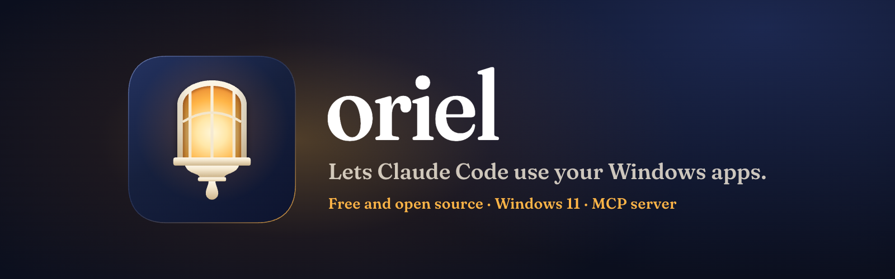
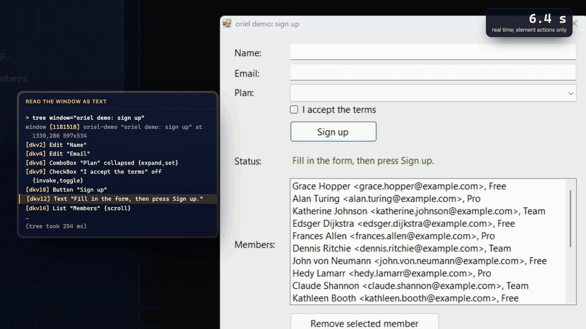

<p align="center">
  
</p>

<p align="center">
  <a href="https://yordilorenzo.github.io/oriel/demo.mp4"></a>
</p>

<p align="center">
  <a href="https://github.com/YordiLorenzo/oriel/actions/workflows/build.yml"></a>
  <a href="https://github.com/YordiLorenzo/oriel/releases/latest"></a>
  <a href="LICENSE"></a>
</p>

**The Claude Code CLI has no built-in computer use on Windows ([docs](https://code.claude.com/docs/en/computer-use),
read 10 Nov 2026). oriel is an MCP server that lets Claude Code use your Windows apps.**

It reads each window as text through the accessibility tree, presses, fills and selects controls through UI
Automation so those actions don't move your mouse, and replies to every action with what changed. One exe under
200 KB, no admin rights, free and open source.

On Microsoft's WindowsAgentArena (round 9, October 2026), the same model ran with only the MCP server swapped. Tasks
took a median 49 s with oriel against 70 s with Cua Driver 0.38.0 (mean 74 s against 90 s). The model cost Claude
Code reported was $38 against $61 per run of 153 tasks. Cua Driver completed 4 points more tasks: 67% against 63%. It
ran without 4 of its 63 tools, `run_script` among them ([details](#how-it-compares)).

oriel isn't code-signed yet, so SmartScreen warns and Smart App Control, where it is on, blocks it
([what to expect](#windows-warns-about-orielexe)). Tested on Windows 11 with Claude Code.

[Download for Windows](https://github.com/YordiLorenzo/oriel/releases/latest) · [Install](#install) ·
[Set up your MCP client](#set-up-your-mcp-client) · [How it compares](#how-it-compares) ·
[What it changes on your PC](#what-oriel-changes-on-your-pc)

What Claude sees, and what it gets back after filling a field:

```
> tree Character Map
window [264694] charmap "Character Map" at 15,65 491x437
[kqm1] Pane "Character Grid"
[kqm3] Edit "Characters to copy :" value=" "
[kqm4] Button "Select"
[kqm5] Button "Copy" (disabled)
[kqm6] CheckBox "Advanced view" off
...
> set id=kqm3 value="hello"
set "Characters to copy :"
~ [kqm3] Edit "Characters to copy :" value="hello"
~ [kqm5] Button "Copy"
(set took 9 ms)
```

## Install

oriel needs no admin rights and installs no service or driver. `oriel uninstall` removes everything it added
([the full list](#what-oriel-changes-on-your-pc)).

1. Download `oriel.exe` from the [latest release](https://github.com/YordiLorenzo/oriel/releases/latest). To check
   the file, compare `(Get-FileHash .\oriel.exe).Hash` with the release's `SHA256SUMS`.
   `gh attestation verify oriel.exe -R YordiLorenzo/oriel` also checks that this repository's release workflow built
   it.
2. In PowerShell, in the download folder:

   ```powershell
   .\oriel.exe install
   ```

   This copies oriel to `%LOCALAPPDATA%\Programs\oriel` and starts it. Add `--autostart` if you want it running from
   the moment you sign in. It ends by printing the config for Claude Code, Claude Desktop, Cursor,
   Codex and SSH, with your real path filled in, ready to paste.
3. Add it to Claude Code, in the same PowerShell window:

   ```powershell
   claude mcp add --scope user oriel -- "$env:LOCALAPPDATA\Programs\oriel\oriel.exe" mcp
   ```

   Or use the Claude Code plugin instead of steps 1 to 3 (Claude Code 2.1.292 or later, and
   [Git for Windows](https://git-scm.com/downloads/win), which Claude Code uses to fetch the plugin):

   ```powershell
   claude plugin install oriel --marketplace YordiLorenzo/oriel
   ```

   The plugin carries its own `oriel.exe`, the one from the release with the same version, so there is nothing to
   download first. On an older Claude Code, run `claude plugin marketplace add YordiLorenzo/oriel`, then
   `claude plugin install oriel@oriel`. Use the plugin or `claude mcp add`, not both. Other clients and use from a
   Mac: [Set up your MCP client](#set-up-your-mcp-client).
4. Start `claude` and paste one of these. Each press and fill replies with what changed in the window.

   ```
   Open Calculator and work out 127 times 46 by pressing its buttons.
   ```

   ```
   Open Notepad, write a three-line note and save it in Documents as oriel-test.txt.
   ```

Did it work? Say so in [Discussions](https://github.com/YordiLorenzo/oriel/discussions/6). If it didn't, the
[bug report form](https://github.com/YordiLorenzo/oriel/issues/new?template=bug_report.yml) asks for what helps.

### Windows warns about oriel.exe

oriel isn't code-signed yet, so Windows doesn't recognise the publisher:

- **Your browser** may say "oriel.exe isn't commonly downloaded". In Edge, point at the file in the downloads list,
  open its **...** menu and choose **Keep**. In "Make sure you trust oriel.exe before you open it", open the arrow
  next to **Delete** and choose **Keep anyway**.
- **Running it:** `.\oriel.exe install` in PowerShell, as in step 2, showed no further prompt in a test on Windows 11
  on 11 Nov 2026. Opened from File Explorer, Windows may ask "Are you sure that you want to run this software?" (click
  **Run**), and SmartScreen may show "Windows protected your PC" (click **More info**, then **Run anyway**).
- **Smart App Control**, where it is on, blocks oriel.exe. It blocks unsigned programs that Windows doesn't know yet,
  including ones you build yourself, and it has no way to let one program through
  ([Microsoft's FAQ](https://support.microsoft.com/en-us/windows/security/threat-malware-protection/smart-app-control-frequently-asked-questions)).
- **Antivirus** may be wary of an unsigned program that sends keystrokes and reads other windows. oriel doesn't try
  to get around it.
- **A build of your own** ([Build from source](#build-from-source)) avoids SmartScreen's download warning, because
  the file doesn't come from the internet. Smart App Control still checks it.

Every new version starts with no reputation, so expect the same warnings when you update. oriel will apply to
SignPath Foundation for free code signing, so that Windows names the publisher.
[Code signing policy](docs/code-signing.md): what will be signed, and who approves it.

### Updating

Run `install` from the new `oriel.exe` (with `--autostart` again if you use it). It stops the running copy and
replaces it. Your client config points at the installed path, so it stays as it is. With the plugin, run
`claude plugin update oriel@oriel`, stop the running copy (`Stop-Process -Name oriel`), and restart Claude Code. To
hear about new releases,
choose **Watch > Custom > Releases** on this repository, or follow the
[releases feed](https://github.com/YordiLorenzo/oriel/releases.atom).

### Uninstalling

```powershell
& "$env:LOCALAPPDATA\Programs\oriel\oriel.exe" uninstall
```

This stops oriel, removes the logon entry if there is one, deletes the install and settings folders, and lists what
it removed. Then remove oriel from your MCP client: in Claude Code, `claude mcp remove --scope user oriel`. With the
plugin, run `claude plugin uninstall oriel@oriel` instead. To remove oriel's settings too, stop any copy that still
runs (`Stop-Process -Name oriel`), then delete the `%LOCALAPPDATA%\oriel` folder.

## What it does

Screenshot-based computer use sends the model an image at every step and clicks at pixel positions. Windows already
describes every window as a tree of named controls, for screen readers. oriel hands that tree to the assistant as
text, acts on the controls directly, and answers each action with what changed, so the assistant rarely has to look
twice.

### Reads windows as text

- **Every control on one line.** `tree` lists a window's named and actionable controls, each with a ref such as
  `kqm17` that later calls use directly, without searching again.
- **Milliseconds per call.** An action takes 5 to 20 ms and reading a window 20 to 60 ms
  ([measured](docs/benchmarks.md#1-latency-per-call-benchlatencypy) over SSH, 21 and 22 Oct 2026). oriel turns off
  UI Automation's AutoSetFocus, which otherwise stalls every action for 2 seconds on a locked or busy desktop.
- **Search and wait.** `find` looks for controls by name, including off-screen ones. `wait` returns as soon as a
  window or control appears, driven by the app's own events instead of fixed sleeps.

### Acts, and says what changed

- **Change reports.** Every action replies with what changed in the window: `+` new, `~` changed, `-` gone, and
  `+ window` with the tree of a window that opened. The assistant doesn't have to read the window again to see
  whether it worked.
- **Works in the background.** `invoke`, `set`, `select` and `scroll` act through UI Automation. They don't take
  keyboard focus or move the mouse, so you can keep working while the assistant does.
- **Keys and mouse when needed.** `keys`, `click` and `drag` send real input for what has no accessibility action,
  such as spreadsheet cells, canvases and drawing. They check that the right window is in front and wait for a pause
  in your own typing first.
- **Fewer model turns.** `launch` replies with the new window's tree, `batch` runs several steps in one call, and a
  name that matches nothing comes back with the closest names.

### Keeps away from passwords and terminals

- **No shell by default.** No tool runs commands or reads files, and open terminals are off limits.
- **No passwords or sign-in.** Password fields, the lock screen, sign-in and UAC prompts, credential dialogs and
  common password managers can't be read or typed into.
- **It acts as you.** In an allowed window the assistant can do what you can, so an allow-list in `config.json`
  keeps it to the apps you name. oriel is not a sandbox: [SECURITY.md](SECURITY.md) has every rule and its limits.

### Reaches your other computers

- **From a Mac or Linux machine.** Run the assistant there and reach the PC over SSH. oriel passes each call to its
  copy running in your desktop session. [Set up your MCP client](#set-up-your-mcp-client) shows the command.
- **oriel-vnc** is the second MCP server in this repo. It runs next to the assistant and operates any desktop with a
  VNC server, such as a Mac or a Linux machine, through screenshots, clicks and keys. Nothing is installed on those
  machines. [vnc/README.md](vnc/README.md)

## Supported

| | Works | Not yet |
|---|---|---|
| **Windows** | Windows 11, tested, on the .NET Framework 4.8 that Windows includes | Windows 10 isn't tested yet. Version 1903 or later should work, since it includes the .NET Framework 4.8 |
| **Apps** | Anything that exposes UI Automation: most desktop apps, Store apps, and web pages in Chromium browsers and Electron apps. WindowsAgentArena exercised Chrome, Edge, File Explorer, LibreOffice Calc and Writer, VS Code, VLC, Settings, Paint, Clock, Calculator and Notepad | Canvases and games have no accessibility tree: `screenshot`, `click` and `drag` cover them, or oriel-vnc. Apps running as administrator need oriel to run as administrator too |
| **MCP clients** | Any client that starts a stdio MCP server; tested with Claude Code | The Codex, Claude Desktop, Cursor and VS Code configs below follow each client's documented format but aren't tested |
| **A locked PC** | Reading windows and element actions | `keys`, `focus`, `click` and `drag` are refused, and Windows suspends Store apps until you unlock |
| **Other computers** | macOS, Linux and anything else with a VNC server, through oriel-vnc | |

### Tools

| Tool | What it does |
|---|---|
| `windows` | Visible windows, front first, dialogs included |
| `tree` | One window's named or actionable controls, each with a ref like `kqm17` |
| `find` | Controls whose name contains a text, including off-screen ones |
| `text` | Read a document or field |
| `wait` | Wait until a window or control appears |
| `invoke` | Press, toggle, select or expand (by ref, or window and name) |
| `set` | Fill a field, or set a slider |
| `select` | Pick an item by its text in a combo box, list, tab strip or menu |
| `scroll` | Scroll a control into view, or a list or page by a page or line |
| `keys` | Keystrokes, after the checks in [SECURITY.md](SECURITY.md) |
| `click`, `drag` | Real mouse input on a control or a point in a window |
| `launch` | Start a program, file or URI; replies with the new window's tree |
| `window` | Minimise, maximise, restore, move or resize |
| `screenshot` | A picture of one window, for canvases, charts and games |
| `focus`, `close`, `status` | Bring a window to the front, close one, see whether the PC is locked and you are idle |
| `batch` | Several of the above in one call |

Every tool and its options: [docs/tools.md](docs/tools.md). How it is built and why it is fast:
[docs/design.md](docs/design.md).

## Set up your MCP client

Every client needs the same two things: the full path to the installed `oriel.exe` as the command, and `mcp` as the
argument.

`oriel install` ends by printing the Claude Code line, the Codex and the Claude Desktop/Cursor
blocks and the SSH line below with your real path filled in and the backslashes already doubled where JSON and TOML
need it, so you can paste them as they are. It doesn't print the VS Code or oriel-vnc blocks. With 0.1.0, or without
that output, replace `<you>` below with your Windows user name. Restart the client after editing its file.

| Client | Command or config file |
|---|---|
| Claude Code | `claude mcp add --scope user oriel -- "$env:LOCALAPPDATA\Programs\oriel\oriel.exe" mcp` (in PowerShell), or `claude plugin install oriel --marketplace YordiLorenzo/oriel` |
| Codex | `%USERPROFILE%\.codex\config.toml` |
| Claude Desktop | `%APPDATA%\Claude\claude_desktop_config.json`, or the `.mcpb` bundle |
| Cursor | `%USERPROFILE%\.cursor\mcp.json` |
| VS Code | `.vscode\mcp.json` in a workspace |

**Codex:**

```toml
[mcp_servers.oriel]
command = "C:\\Users\\<you>\\AppData\\Local\\Programs\\oriel\\oriel.exe"
args = ["mcp"]
```

**Claude Desktop, Cursor** and other clients with an `mcpServers` list:

```json
{
  "mcpServers": {
    "oriel": { "command": "C:\\Users\\<you>\\AppData\\Local\\Programs\\oriel\\oriel.exe", "args": ["mcp"] }
  }
}
```

**Claude Desktop** can also install oriel as an extension: download
`oriel-<version>-win-x64.mcpb` from the [latest release](https://github.com/YordiLorenzo/oriel/releases/latest) and
open it with Claude Desktop. This way isn't tested yet.

**VS Code:**

```json
{
  "servers": {
    "oriel": { "type": "stdio", "command": "C:\\Users\\<you>\\AppData\\Local\\Programs\\oriel\\oriel.exe", "args": ["mcp"] }
  }
}
```

**From a Mac or Linux machine,** over SSH. The PC needs OpenSSH Server with key login. Turning it on needs admin once;
oriel itself needs none.

```
claude mcp add --scope user oriel -- ssh '<you>@my-windows-pc' 'C:\Users\<you>\AppData\Local\Programs\oriel\oriel.exe' mcp
```

`<you>` is your Windows user name, which is often not the same as your Mac or Linux one. An SSH session has no
desktop, so oriel passes each call to its copy running in your desktop session, and starts that copy if it isn't
running. The Claude Code plugin works only on the Windows PC itself; from a Mac, use this line.

**oriel-vnc,** for any desktop over VNC, with [uv](https://docs.astral.sh/uv/) installed and your machines listed in
`~/.config/oriel-vnc/hosts.json` ([vnc/README.md](vnc/README.md)):

```
claude mcp add --scope user oriel-vnc -- uvx oriel-vnc
```

To check oriel without a client, run `& "$env:LOCALAPPDATA\Programs\oriel\oriel.exe" call windows` in PowerShell.

## What oriel changes on your PC

| Change | When | How to undo it |
|---|---|---|
| `oriel.exe` in `%LOCALAPPDATA%\Programs\oriel` | `oriel install` | `oriel uninstall` deletes the folder |
| The plugin, with its own `oriel.exe`, in `%USERPROFILE%\.claude\plugins\cache\oriel\oriel\<version>` | `claude plugin install` | `claude plugin uninstall oriel@oriel`; Claude Code deletes the folder later |
| `%LOCALAPPDATA%\oriel`: the per-user key (`token`), a counter for refs, and `config.json` if you make one | The first time oriel runs | `oriel uninstall` deletes the folder |
| A logon entry, `oriel` under `HKCU\Software\Microsoft\Windows\CurrentVersion\Run`, that starts oriel without a window | `oriel install --autostart` only | `oriel uninstall` removes it |
| A one-time scheduled task, `oriel-start`, that starts oriel in your desktop session | When a client connects over SSH and oriel isn't running; deleted once it has started | Nothing to undo |
| oriel listening on `127.0.0.1`, on a port of its own per Windows user, for clients that hold the per-user key | While it runs | `oriel uninstall` stops it; signing out does too |

oriel needs no admin rights, installs no service or driver, and makes no network connections except to itself on
`127.0.0.1`. Your AI client sends what oriel reads (window titles, control names, the text you ask it to read) to its
model provider, as it does with anything else you show it.

## How it compares

|  | oriel | Cua Driver | Screenshot-based agents |
|---|---|---|---|
| How it sees a window | The accessibility tree, as text | The accessibility tree, as text, with screenshots on request | Screenshots, read by the model |
| How it acts | Accessibility actions on the control; real keys and mouse only for `keys`, `click` and `drag` | Accessibility actions on element tokens, plus keyboard and mouse tools | Mouse clicks at pixel positions, and typing |
| What an action changed | In the same reply, control by control | Read the window again | A new screenshot, compared by eye |
| Canvases and games | `screenshot`, `click` and `drag`, or oriel-vnc | Screenshots and mouse | What they are built for |

**WindowsAgentArena** is Microsoft's benchmark of everyday tasks in a Windows 11 VM, scored by its own scripts. In
round 9 (October 2026), both sides ran Claude Sonnet 5.5 in Claude Code with the same prompt and a 50-turn limit; only
the MCP server was swapped. Two runs each, averaged over the 153 tasks scored in every run:

| | oriel | Cua Driver 0.38.0 | Difference |
|---|---|---|---|
| Time per task, median (mean) | **49 s** (74 s) | 70 s (90 s) | 30% less time with oriel (median) |
| Model cost per run of 153 tasks, as Claude Code reported it | **$38** | $61 | 38% lower with oriel |
| Model turns per task | **21.8** | 27.0 | 19% fewer with oriel |
| Tasks completed | 96.2 (63%) | **102.7 (67%)** | Cua Driver 4 points more |

- **Time, cost and turns:** each gap is larger than the gap between either layer's own two runs. The benchmark
  doesn't show which of oriel's features made the difference.
- **Completion:** Cua Driver completed 4.2 points more. Its own two identical runs differed by 6.5 points, so the gap
  is within run-to-run variation, but Cua Driver was also ahead in every round since round 5
  ([every round](docs/benchmarks.md#every-round)).
- **Cua Driver's version and tools:** round 9 ran Cua Driver 0.38.0 without 4 of its 63 tools. `run_script` runs
  JavaScript over Cua Driver's own tools in a sandbox with no file, network or process access; it was hidden because
  oriel has no script tool. `install_ffmpeg` and `install_extension` install software, and `check_for_update` checks
  GitHub for a newer driver. Cua Driver 0.46.1, the newest on 10 Nov 2026, has not run on WindowsAgentArena.
- **Cost** is the figure Claude Code reported, worked out from its list prices: an estimate, not a bill.

Every run, the 95% intervals and the earlier rounds: [bench/waa/RESULTS.md](bench/waa/RESULTS.md). Before you quote
a number, read [what this does not show](docs/benchmarks.md#what-this-does-not-show).

Per call, on 10 Nov 2026, against Cua Driver 0.46.1, the newest release that day, and agent-desktop 1.2.0 (released
5 Nov 2026), all three in one session (unlocked Windows 11 PC, median of 5 runs,
[bench/headtohead/RESULTS.md](bench/headtohead/RESULTS.md#2026-11-10-second-run-agent-desktop-120-added)):

| Call | oriel 0.1.0 | Cua Driver 0.46.1 | agent-desktop 1.2.0 |
|---|---|---|---|
| List windows | **2 ms** | 31 ms | 44 ms |
| Launch an app | **193 ms** | 605 ms | 251 ms |
| Read a window | **21 ms** | 37 ms | 143 ms |
| Fill a field | **2 ms** | 3 ms | 174 ms |
| Press a button | **2 ms** | 6 ms | 187 ms |
| Press, and see what changed | **44 ms**, one call | a second call | a second call |

Choose a screenshot-based agent if most of the work is in games, canvases or remote desktops, where there is no
accessibility tree. If completion is what you need most, Cua Driver is a fair choice. Choose oriel if your assistant
works in everyday Windows apps and you want each task done in less time and fewer turns.

Method, every round, the per-call timings of all five servers measured and the rules against tuning to the benchmark:
[docs/benchmarks.md](docs/benchmarks.md). What comes next: [ROADMAP.md](ROADMAP.md).

## FAQ

### Is it safe to let an AI assistant use my PC?

Treat it like someone using your PC on your behalf: in the windows it may touch, it can do what you can. oriel keeps
it away from passwords, sign-in and UAC prompts, password managers and terminals, gives it no shell by default and no
file tools, and checks every keystroke and click before sending it. It is not a sandbox. [SECURITY.md](SECURITY.md)
lists what oriel guarantees and what it doesn't.

### Which MCP clients does it work with?

Any client that starts a stdio MCP server. Only Claude Code is tested. The Codex, Claude Desktop, Cursor and VS Code
configs under [Set up your MCP client](#set-up-your-mcp-client) follow each client's documented format. From release
0.1.1, oriel is in the official MCP Registry as `io.github.YordiLorenzo/oriel` ("oriel for Windows");
`io.github.ParadoxInfinite/oriel` is a different project.

### Why not Claude Desktop's computer use?

On Windows it is a research preview on the Pro, Max and Ultra plans, it works from screenshots, and it hides your
other windows while it works ([docs](https://code.claude.com/docs/en/desktop), read 10 Nov 2026). The Claude Code CLI
has none on Windows. oriel works from the Claude Code CLI, reads windows as text, and its element actions don't move
your mouse or take the focus. oriel was never measured against it.

### Was oriel tuned to the benchmark?

Fixes have to help on any PC, not only in the benchmark. The tasks are split in two: a dev half, whose traces are
read while fixing oriel, and a held-out half that is never read. Every result is reported for both halves.
[bench/waa/README.md](bench/waa/README.md#not-tuning-to-the-benchmark) has the rules.

### Can I keep using the PC while the assistant works?

For reading and element actions, yes. `keys`, `click`, `drag` and `focus` bring a window to the front, so they
interrupt you; they wait for a pause in your typing and mouse use, and are refused if you keep going.

### Does oriel send anything online?

No. It only talks to itself on `127.0.0.1`. Your MCP client sends what oriel reads to its model provider.

### How do I stop it starting at sign-in?

It only starts at sign-in if you installed it with `--autostart`. `oriel uninstall` removes the logon entry along
with everything else.

### Where are its settings?

In `%LOCALAPPDATA%\oriel\config.json`, which doesn't exist until you make one. It takes `deny` (more windows to keep
off limits), `allow` (only these programs) and `shell`. See [SECURITY.md](SECURITY.md).

### Why the .NET Framework and C# 5?

They come with Windows. There is nothing to install, and the exe builds with the C# compiler Windows already has.

## Build from source

No SDK needed; the C# compiler that ships with Windows is enough:

```powershell
git clone https://github.com/YordiLorenzo/oriel.git
cd oriel
powershell -ExecutionPolicy Bypass -File build\build.ps1    # -> dist\oriel.exe
```

The build generates the UI Automation interop from Windows' own type library and embeds it, so the exe stands
alone. The benchmarks and how to run them are in [bench/README.md](bench/README.md).

## Contributing

Bug reports, apps oriel can't read or act on, and fixes of any size are welcome. Report an app with the
[App oriel can't read](https://github.com/YordiLorenzo/oriel/issues/new?template=app_report.yml) form, and ask
questions in [Discussions](https://github.com/YordiLorenzo/oriel/discussions).
[CONTRIBUTING.md](CONTRIBUTING.md) explains how to build, test and send a change. Everyone here follows the
[code of conduct](CODE_OF_CONDUCT.md). Please report security problems privately, as [SECURITY.md](SECURITY.md)
describes, not in a public issue.

## Licence

oriel is free and open source under the [Apache License 2.0](LICENSE).

oriel is not affiliated with or endorsed by Microsoft, Anthropic, Cua or the makers of the other tools named here.
Their names are trademarks of their owners and appear here only to say what oriel works with or is compared to.
